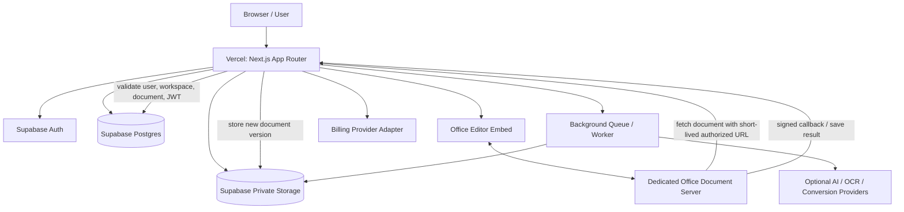
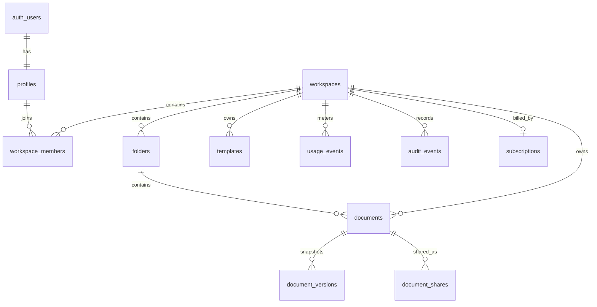

# Architecture and Technology Stack — Forma Office

## 1. Architecture decision

### Recommended architecture

Use **Next.js + Supabase + Vercel as the product platform**, and a **dedicated office document server** for actual DOCX/XLSX/PPTX/PDF editing. Do not try to implement Word-compatible pagination, import/export and collaborative editing from scratch inside a 15-day Next.js project.

Recommended first engine to evaluate: **ONLYOFFICE Docs**. Its documented API embeds editors for word-processing, spreadsheets and presentations; it uses a server callback to return saved documents and supports JWT-based validation. The current official format matrix must be checked for the exact deployed version because view, edit, review, comment and conversion support differ by format.

### Licensing gate — mandatory before commercial launch

- ONLYOFFICE Docs Community Edition is distributed under AGPLv3.
- ONLYOFFICE's licensing FAQ states that using its AGPL products in a network/SaaS model can require making the modified version and derivative work available under AGPLv3. If the product must remain proprietary, evaluate and purchase the correct commercial Developer license or choose another engine with a license that supports the intended deployment.
- Do not rely on an AI agent's legal interpretation. Obtain legal review of the specific edition, integration, deployment topology and distribution model before launch.
- For a portfolio/open-source experiment, Community Edition may be used only with an understanding of and compliance with AGPLv3 obligations.

### Why not make Tiptap the primary office engine?

Tiptap is a strong foundation for an original web content editor. Its current DOCX conversion package is a Pro product and supports DOCX import/export and some other exports, but the conversion page explicitly describes a conversion bridge rather than a full document renderer; page layout, headers/footers and collaboration require additional pieces. It can be an alternative for a controlled custom editor, but it should not be called WPS-level Word compatibility without extensive fixture testing.

## 2. High-level system diagram



### Responsibility boundaries

| Component | Owns | Must not own |
|---|---|---|
| Next.js/Vercel | UI, app API, auth-aware server actions, editor config signing, callback endpoint, entitlements | Persistent office engine process or long-running OCR/AI workers |
| Supabase Auth | User identity/session | Application role decisions without app/RLS checks |
| Supabase Postgres | Workspace, document metadata, shares, roles, versions, audit and usage metadata | Large binary document contents |
| Supabase Storage | Original files, saved versions, exports and template binaries | Authorization decisions on its own; use Storage RLS |
| Office document server | Editing, layout, supported format import/export, editor collaboration features | App billing, user membership and canonical workspace permissions |
| Worker/queue | Long-running OCR, conversions, malware scan, thumbnails, AI jobs | Interactive browser session handling |
| Billing provider | Payment lifecycle and subscription events | Directly authorizing document access without synced entitlements |

## 3. Frontend stack

- **Framework:** Current stable Next.js App Router with React and TypeScript strict mode.
- **Language:** TypeScript, strict compiler options.
- **Styling:** Tailwind CSS with CSS variables/design tokens.
- **Components:** shadcn/ui patterns; customize rather than ship generic defaults unchanged.
- **Icons:** Lucide React with consistent stroke and sizing.
- **Forms:** React Hook Form + Zod.
- **Server data:** Server Components and Route Handlers for secure data reads/writes; use Server Actions only where they fit and still validate authorization.
- **Client cache/state:** TanStack Query for client-side remote data when needed; Zustand only for app-level ephemeral UI state. Do not duplicate editor document state in Zustand.
- **Tables/lists:** TanStack Table if the document library needs rich sorting/filtering.
- **Editor:** Embedded office editor component (e.g. ONLYOFFICE Docs) for document canvas. Build the surrounding library, navigation, settings, templates and billing experience in Next.js.
- **Testing:** Playwright for E2E; Vitest for unit tests; React Testing Library for components; axe for accessibility checks.

Use Server Components by default. Keep the editor embed, toolbar integration and interactions inside focused Client Components.

## 4. Backend and data services

- **Database:** Supabase Postgres.
- **Identity:** Supabase Auth with cookie-based SSR session handling through `@supabase/ssr` and the current official Next.js guide.
- **File storage:** Supabase Storage with private bucket(s), object-level RLS and short-lived signed URLs where appropriate.
- **Realtime:** Supabase Realtime for app notifications, presence or metadata updates if needed. Do not use it as a replacement for the office engine's document collaboration protocol.
- **Background processing:** External queue/worker for large conversion, OCR, antivirus scanning, thumbnail generation and long AI jobs. Examples include a managed queue/worker service or a small container service. Choose only after measuring volume and cost.
- **Monitoring:** Structured server logs with redaction, error tracking, uptime/health checks and basic product metrics. Never log document content or secrets.

## 5. Office editor integration contract

Implement a server-side integration layer, not a direct browser-to-editor configuration assembled with secrets.

### Open editor sequence

1. Browser requests editor configuration for a document.
2. Next.js server authenticates the user.
3. Server checks workspace membership, document permission, plan entitlement, file status and supported format.
4. Server creates a short-lived document access URL or a controlled download endpoint that the document server can reach.
5. Server generates a stable document key for the current saved revision/session according to the editor's requirements.
6. Server builds the editor config with document title, file type, URL, permissions, callback URL and current user's editor identity.
7. Server signs the configuration with the office server JWT secret.
8. Browser receives the editor config/token (never the signing secret) and initializes the editor.

### Save callback sequence

1. Office editor server sends callback to a dedicated Next.js Route Handler.
2. Handler validates the request signature/JWT according to the editor's current official docs.
3. Handler validates document identifier, callback status, expected document key, source IP/network controls where feasible, file size and document/workspace state.
4. Handler obtains the saved binary from the trusted editor callback URL using server-side validation; do not accept arbitrary untrusted URLs.
5. Handler writes a new immutable object/version to private Storage.
6. Handler updates document metadata and current version inside a transaction/consistent workflow.
7. Handler records an audit event and returns the exact success response required by the editor API.
8. App updates status/version metadata; failures are retryable and observable.

Consult the current official Docs API for exact callback statuses, JWT placement, callback payload, forced-save behavior and document-key lifecycle. Do not assume callback behavior from an old tutorial.

## 6. Supabase database model

Use UUID primary keys, `created_at`/`updated_at` timestamps, foreign keys, check constraints and indexes. Keep file bytes in Storage.

### Core tables

| Table | Key fields | Purpose |
|---|---|---|
| `profiles` | `id` = auth user id, `display_name`, `avatar_path`, `locale` | User-facing profile |
| `workspaces` | `id`, `name`, `owner_id`, `plan_key`, `created_at` | Personal/team workspace |
| `workspace_members` | `workspace_id`, `user_id`, `role`, `status`, `joined_at` | Membership and role |
| `folders` | `id`, `workspace_id`, `parent_id`, `name`, `created_by` | Folder hierarchy |
| `documents` | `id`, `workspace_id`, `folder_id`, `owner_id`, `title`, `extension`, `mime_type`, `storage_path`, `size_bytes`, `current_version_id`, `editor_key`, `status` | Canonical document metadata |
| `document_versions` | `id`, `document_id`, `version_number`, `storage_path`, `checksum`, `created_by`, `source`, `created_at` | Immutable saved versions |
| `document_shares` | `id`, `document_id`, `subject_user_id` or `invite_email`, `role`, `token_hash`, `expires_at`, `revoked_at` | Explicit shares/invites |
| `templates` | `id`, `workspace_id` nullable, `name`, `category`, `preview_path`, `file_path`, `is_public`, `created_by` | Original system/team templates |
| `subscriptions` | `workspace_id`, `provider`, `provider_customer_id`, `provider_subscription_id`, `status`, `period_end` | Billing state mirror |
| `entitlements` | `plan_key`, `feature_key`, `limit_value`, `enabled` | Server-enforced plan capability definitions |
| `usage_events` | `workspace_id`, `user_id`, `feature_key`, `quantity`, `event_id`, `created_at` | Usage metering and quotas |
| `audit_events` | `workspace_id`, `actor_id`, `entity_type`, `entity_id`, `action`, `metadata_redacted`, `created_at` | Security and operational audit trail |

Optional tables:
- `document_comments` only if comments are owned by the app rather than by the office engine.
- `ai_jobs` for asynchronous AI tasks; store provider/job metadata, not full document text.
- `conversion_jobs` and `scan_jobs` for long-running processing.
- `user_preferences` for toolbar/layout/font settings.

### Relationships



### Required indexes and constraints

- Index `workspace_members(user_id, workspace_id)` and `(workspace_id, role)`.
- Index `documents(workspace_id, folder_id, updated_at DESC)`.
- Unique constraint for version number per document.
- Unique/normalized share invitation token hash; never store raw invite token.
- Check allowed membership role values.
- Check document status values and non-negative size/quota fields.
- Use indexes that support RLS predicates; inspect query plans for large file libraries.
- Use soft-delete timestamps where recoverability is a requirement.

## 7. Authorization and RLS model

RLS is mandatory on every user-owned table. A user's ability to see a document is based on workspace membership and explicit document share permissions, not on knowing a UUID.

Suggested role rules:

- `owner`: all workspace operations and billing.
- `admin`: membership and workspace settings (not ownership transfer unless explicitly allowed).
- `editor`: create/edit documents and folders within allowed workspace scope.
- `commenter`: read and comment, but cannot modify document body.
- `viewer`: read only.

Implement helper SQL functions such as `is_workspace_member(workspace_id)` and `has_document_permission(document_id, required_role)` only after checking `SECURITY DEFINER`, fixed `search_path`, privileges and recursion risks. Prefer simple policies where possible.

Storage object policy must enforce workspace/document authorization on upload, read, update and delete. Use private buckets and the documented Storage RLS approach. Do not directly mutate Supabase's internal `storage` schema tables; use Storage APIs.

## 8. Storage convention

Use private buckets, for example:

- `documents`: source/current files.
- `document-versions`: immutable saved versions if separated for policy/lifecycle reasons.
- `templates`: original platform templates; public previews may be separate.
- `exports`: generated PDFs and temporary output.

Suggested object path:

`workspace/{workspace_id}/document/{document_id}/version/{version_id}/source.docx`

For temporary exports:

`workspace/{workspace_id}/document/{document_id}/exports/{job_id}/document.pdf`

Do not trust a path supplied by the browser. Build paths server-side from authorized IDs. Use short-lived signed URLs or controlled streaming endpoints. Use file checksums to detect duplicate/corrupt uploads.

## 9. Environment variables and secrets

Create `.env.example` with placeholder names only. Store actual values in ignored `.env.local` for development and Vercel's environment-variable settings for Preview/Production.

Example names (adjust to selected Supabase API key model):

```dotenv
# Browser-safe, public project configuration only
NEXT_PUBLIC_APP_URL=http://localhost:3000
NEXT_PUBLIC_SUPABASE_URL=https://YOUR_PROJECT.supabase.co
NEXT_PUBLIC_SUPABASE_PUBLISHABLE_KEY=YOUR_PUBLIC_PUBLISHABLE_KEY

# Server-only Supabase privileged access; never prefix with NEXT_PUBLIC_
SUPABASE_SERVICE_ROLE_KEY=YOUR_SERVER_ONLY_SECRET

# Office document server
ONLYOFFICE_DOCUMENT_SERVER_URL=https://docs.example.com
ONLYOFFICE_JWT_SECRET=YOUR_SERVER_ONLY_JWT_SECRET
ONLYOFFICE_CALLBACK_BASE_URL=https://your-app.example.com/api/office/callback

# Optional AI provider (server-only)
OPENAI_API_KEY=YOUR_SERVER_ONLY_AI_KEY
ANTHROPIC_API_KEY=YOUR_SERVER_ONLY_AI_KEY

# Optional billing provider (server-only; only after provider/country checks)
BILLING_PROVIDER_SECRET_KEY=YOUR_SERVER_ONLY_BILLING_KEY
BILLING_WEBHOOK_SECRET=YOUR_WEBHOOK_SIGNING_SECRET
```

Rules:
- Do not create a `.env` file committed with real values.
- Add `.env*` exclusions to `.gitignore`, but keep `.env.example` committed.
- Only expose explicitly public publishable keys through `NEXT_PUBLIC_*`.
- Do not expose `SUPABASE_SERVICE_ROLE_KEY`, `ONLYOFFICE_JWT_SECRET`, AI provider keys, webhook secrets or billing keys.
- Use separate Supabase/Vercel credentials for local, Preview and Production.
- Rotate any secret that is pasted into chat, committed, printed in logs or included in a screenshot.
- Restrict access to production environment variables by role.
- Prefer the current Supabase publishable/secret key model; follow the exact current dashboard guidance rather than copying deprecated key patterns.

## 10. Vercel and worker hosting

- Vercel hosts the Next.js application, server routes and Preview/Production deployments.
- Git branch/PR integration should generate a Preview deployment for each daily branch.
- The office document server must run on a separate persistent Linux/container host that can be reached by both the browser and application server. Configure HTTPS, network ingress/egress, storage access and JWT.
- OCR, conversion, malware scanning, thumbnails and long AI tasks should run in a worker/queue environment where job retries and timeouts can be controlled.
- Do not run a persistent Dockerized office server inside Vercel Functions. Function duration/memory limits make it the wrong runtime for a persistent office server.
- Store host URLs and secrets in the matching environment, and test Preview and Production independently.

## 11. API surface proposal

Use Next.js Route Handlers under `/app/api`. Every route authenticates, validates, checks authorization/entitlement and returns typed errors.

| Method + route | Responsibility |
|---|---|
| `GET /api/workspaces/current` | Current user's workspace and role |
| `GET /api/documents` | Paginated document list with filters |
| `POST /api/documents` | Create document metadata and starter file |
| `POST /api/documents/upload` | Validate and upload file |
| `GET /api/documents/:id` | Document metadata after permission check |
| `PATCH /api/documents/:id` | Rename/move/update metadata |
| `DELETE /api/documents/:id` | Soft-delete or delete after authorization |
| `POST /api/documents/:id/editor-config` | Create signed editor configuration |
| `POST /api/office/callback` | Receive/validate editor save callback |
| `GET /api/documents/:id/versions` | List authorized version history |
| `POST /api/documents/:id/restore/:versionId` | Create current version from previous version |
| `POST /api/documents/:id/share` | Create share/invite |
| `DELETE /api/shares/:id` | Revoke share |
| `POST /api/documents/:id/export` | Enqueue export/convert where needed |
| `POST /api/ai/actions` | Entitlement-checked opt-in AI operation |
| `GET /api/health` | Public-safe readiness check, no secrets |

Do not expose internal Storage paths or service-role credentials in API responses.

## 12. Code organization proposal

```text
src/
  app/
    (marketing)/
    (auth)/
    (workspace)/
      home/
      files/
      templates/
      settings/
      editor/[documentId]/
    api/
      documents/
      office/callback/
      ai/
      health/
  components/
    ui/
    layout/
    library/
    editor/
    templates/
  features/
    auth/
    workspaces/
    documents/
    sharing/
    versions/
    billing/
    ai/
  lib/
    supabase/
      client.ts
      server.ts
      middleware.ts
    office/
      config.ts
      jwt.ts
      callback.ts
      format-capabilities.ts
    security/
      authorization.ts
      rate-limit.ts
      file-validation.ts
    env.ts
    logger.ts
  server/
    repositories/
    services/
    policies/
  types/
    database.types.ts
    api.ts
supabase/
  migrations/
  seed.sql
docs/
  architecture/
  reverse-engineering/
  evidence/
  handoffs/
```

Adapt to the current repository. Do not create this structure mechanically if a sound existing structure is present.

## 13. Important technical risks

- Document-server deployment and licensing can be the schedule's critical path.
- Document server must be able to fetch authorized source files and post callbacks to the app.
- Fonts must exist on the document server; browser-only web fonts do not guarantee identical output.
- DOCX layout fidelity varies with complex features, fonts and the editor engine version.
- Public signed URLs can leak. Keep expiries short and audit their use.
- Concurrent editor callbacks and autosaves can race. Use revision keys, immutable version snapshots and idempotency.
- Large conversions/OCR may exceed request timeouts. Use asynchronous jobs.
- AI document processing creates privacy, cost, retention and abuse risks. Use opt-in UI, quotas and data minimization.
- A plan badge in the UI is not an entitlement system. Enforce limits on server-side operations.
